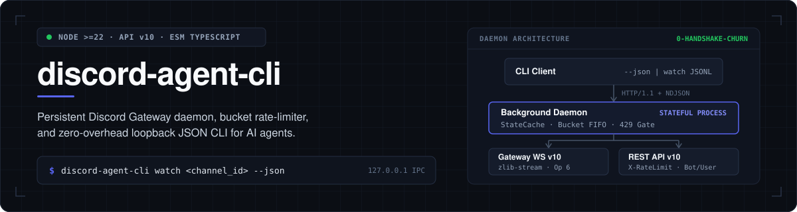

<p align="center">
  <picture>
    <source media="(prefers-color-scheme: dark)" srcset="./assets/banner-dark.svg" />
    <source media="(prefers-color-scheme: light)" srcset="./assets/banner-light.svg" />
    
  </picture>
</p>

# discord-agent-cli

<p>
  <a href="https://github.com/TechBedouin/discord-agent-cli/releases"></a>
  <a href="https://www.npmjs.com/package/@techbedouin/discord-agent-cli"></a>
  <a href="./package.json">=22.0.0" /></a>
  <a href="./tsconfig.json"></a>
  <a href="./LICENSE"></a>
  <a href="https://github.com/TechBedouin/discord-agent-cli/stargazers"></a>
  <a href="#support--donations"></a>
</p>

Standalone **Node.js (`>=22.0.0`)** ESM TypeScript background daemon and CLI for **Discord API v10**, supporting **Official Bot Mode** (`DISCORD_AUTH_MODE=bot`) and **User Mode** (`DISCORD_AUTH_MODE=user`).

- **Persistent Gateway v10 Daemon:** Maintains a single WebSocket connection with `zlib-stream` compression (`node:zlib`), heartbeat/ACK watchdog, and `Op 6 RESUME` session recovery.
- **Rate-Limit Engine:** Route-bucket `X-RateLimit-*` scheduler with preemptive bucket queuing and serialized `429 Retry-After` global/route backoff.
- **In-Memory `StateCache`:** Hydrates guilds, channels, active threads, DMs/group DMs, users, relationships, user settings, bounded per-channel message buffers, and unread/mention watermarks.
- **Zero-Overhead Loopback IPC:** Serves local HTTP/1.1 + NDJSON (`watch`) on `127.0.0.1` discovered via `$DISCORD_CLI_HOME/daemon.json`, protected by a `Host` DNS-rebinding guard and zero local Bearer token overhead.
- **Automation-Ready Output:** Human-readable text by default, strict single-line `--json` envelopes (`{ "ok": true, "data": ... }` / `{ "ok": false, "error": ... }`), and live JSONL `watch` event streaming.

---

## Risks, Security & Discord Terms of Service

> **Strongly Recommended:** Use **Official Bot Mode (`DISCORD_AUTH_MODE=bot`)** with a Discord Developer Portal bot token for all general automation, monitoring, and integrations.

### User Mode (`DISCORD_AUTH_MODE=user`) Risks & ToS Warning
- **Terms of Service Risk:** Automating a regular Discord user account ("self-botting") violates Discord's Terms of Service and carries significant risk of **account lock, phone/CAPTCHA verification challenges, or permanent account suspension**.
- **Elevated Scrutiny Endpoints:** Actions such as joining servers via invite (`join`) and initiating cold/unsolicited direct messages (`dm`) are heavily scrutinized on user accounts and should only be executed rarely with explicit user confirmation.
- **Operational Guardrails:** Never run user-mode tokens on cloud VMs, VPSs, CI runners, or datacenter/rotating IPs; never poll `read` in loops or scrape channels; and always enable human-paced typing (`--typing` or `DISCORD_AUTO_TYPING=1`).
- **Agent Rulebook:** AI agents operating in user mode must strictly follow [./AGENT.md](./AGENT.md) (session hygiene, cache-first reads, circuit breakers on `status --json`, and immediate halt on `401`/`4004`, `429`, or `403`/`captcha_key`).

### Secret Hygiene & Desktop Isolation
- **Privilege Separation:** `DISCORD_TOKEN` (or `DISCORD_BOT_TOKEN`) is read **only** when starting the daemon (`daemon start` / `daemon run`). Routine CLI commands (`status`, `unread`, `read`, `send`, `watch`, etc.) never read `DISCORD_TOKEN`.
- **No Token Persistence:** The token is **never** written to `$DISCORD_CLI_HOME/daemon.json`, never logged to `daemon.log`, and never returned in any IPC or CLI output.
- **Desktop Isolation:** `discord-cli` never reads or touches Discord Desktop profile directories (`%APPDATA%\Discord`, `~/.config/discord`), `settings.json`, `userDataCache.json`, Electron `safeStorage`, LevelDB, or cookies.
- **Never Commit or Leak Tokens:** Keep tokens out of version control, scripts, and logs; if a token is exposed, revoke/rotate it immediately.

---

## Why a Persistent Daemon?

Spawning a fresh Gateway WebSocket per CLI command wastes handshake quota (`session_start_limit`), triggers repeated `Op 2 IDENTIFY` churn, and forces cold-start hydration on every invocation. Running one persistent daemon in the background solves all four problems at once:

- **Zero Handshake Churn:** One long-lived Gateway v10 session maintains heartbeats, `zlib-stream` inflation, and `Op 6 RESUME` across disconnects.
- **Instant Cache-First Reads:** `status`, `guilds`, `channels`, `dms`, `unread`, and tail `read` queries serve hydrated `StateCache` data in milliseconds over loopback TCP.
- **Streaming Over Polling:** `watch <channel_id>` subscribes to live Gateway `Op 0 DISPATCH` updates via NDJSON (`application/x-ndjson`), avoiding REST polling loops.
- **Serialized Rate-Limit Compliance & Privilege Isolation:** Concurrent CLI commands share one `X-RateLimit-*` bucket queue and global `429` gate, while `DISCORD_TOKEN` never leaves the daemon process.

```text
+---------------------------------------------------------------------+
| CLI Client (`discord-cli` / `src/cli/index.ts`)                     |
|  - Discovers `127.0.0.1:<port>` via `$DISCORD_CLI_HOME/daemon.json` |
|  - Zero `DISCORD_TOKEN` env required for normal commands            |
+-------------------------------+-------------------------------------+
                                | Loopback HTTP/1.1 + NDJSON
                                v
+---------------------------------------------------------------+
| Background Daemon (`src/daemon/index.ts`)                     |
|  - GatewayClient (WS v10, zlib-stream, Op 6 RESUME)           |
|  - StateCache (guilds, channels, DMs, messages, watermarks)   |
|  - RateLimiter + DiscordRestClient (bucket FIFO + 429 gate)   |
+-------------------------------+-------------------------------+
                                | WSS v10 + HTTPS v10
                                v
                         Discord API v10
```

---

## Quickstart Guide

### 1. Prerequisites & Installation
Requires **Node.js `>=22.0.0`** (see [./package.json](./package.json)).

**Option A — Install globally from npm (one command, once published):**

```bash
npm install -g @techbedouin/discord-agent-cli
```

*(Or run on demand with `npx @techbedouin/discord-agent-cli status --json`. Both `discord-agent-cli` and `discord-cli` binary aliases are installed on `PATH`.)*

**Option B — Clone & build from source:**

```bash
git clone https://github.com/TechBedouin/discord-agent-cli.git
cd discord-agent-cli
npm install
npm run build
npm link
```

Without `npm link` or a global install, invoke any command with `node dist/cli/index.js <command>` or `npm run cli -- <command>`. Run tests and typechecks with `npm run typecheck` and `npm test`.

### 2. Bot Mode Quickstart (Recommended)

Supply a bot token with either `"Bot "` prefix (auto-detected as `"bot"` mode) or explicit `DISCORD_AUTH_MODE=bot`. Ensure **Message Content Intent** is enabled in the Discord Developer Portal if using default intents (`46593`), or pass unprivileged `DISCORD_INTENTS` (`GUILDS,GUILD_MESSAGES,GUILD_MESSAGE_REACTIONS,DIRECT_MESSAGES,DIRECT_MESSAGE_REACTIONS`).

```bash
# Start background daemon (token required only on start/run)
DISCORD_AUTH_MODE=bot DISCORD_TOKEN="your_bot_token" discord-cli daemon start

# Check health and inspect guilds/channels/messages (no token env needed)
discord-cli status
discord-cli guilds
discord-cli channels <guild_id>
discord-cli read <channel_id> --limit 20
discord-cli send <channel_id> "Hello from discord-cli"

# Stop daemon cleanly
discord-cli daemon stop
```

### 3. User Mode Quickstart (Personal Use — Follow [./AGENT.md](./AGENT.md))

Raw tokens without a `"Bot "` prefix default to `DISCORD_AUTH_MODE=user`. Enable `DISCORD_AUTO_TYPING=1` (and/or `--typing` on `send`/`dm`) so writes emit typing indicators (`40ms/char`, clamped `800..3500ms`) before sending.

```bash
# Start one persistent daemon on your local machine
DISCORD_AUTH_MODE=user DISCORD_AUTO_TYPING=1 DISCORD_TOKEN="your_user_token" discord-cli daemon start --json

# Pre-flight health check before operations
discord-cli status --json

# Cache-first inspection and live NDJSON streaming (avoid polling `read`)
discord-cli unread --json
discord-cli watch <channel_id> --events message_create,reaction_add,gateway_state --json

# Human-paced reply with typing indicator
discord-cli send <channel_id> "Looks good!" --reply <message_id> --typing --json
```

---

## Command Summary

Global flags (accepted before or after the subcommand): `--json`, `--port <number>`, `--home <path>`, `--help` / `-h`, `--version` / `-v`, and `--` (end of flags for `-`-prefixed message text).

| Command | Purpose |
|---|---|
| `status` | Show daemon PID, `authMode`, Gateway state/latency, account, cache counts, and rate-limit status |
| `guilds` | List joined guilds (cache-first, falls back to REST) |
| `channels <guild_id>` | List channels, categories, and active threads in a guild |
| `members <channel_id> [--limit N]` | List unique users observed in channel activity (`1..1000`, default `50`) |
| `dms` | List open DM and group DM channels |
| `dm <user_id> <message...> [--typing]` | Send a direct message (`1..2000` chars) to a user |
| `unread [--mentions-only] [--no-dms]` | List unread channels/DMs and mention counts from `StateCache` |
| `read <channel_id> [--limit N] [--mark-read] [--before <id>] [--after <id>]` | Read `1..100` messages (default `50`), optionally advancing the read watermark |
| `send <channel_id> <message...> [--reply <message_id>] [--typing]` | Send a channel message (`1..2000` chars) through the rate-limited REST queue |
| `react <channel_id> <message_id> <emoji> [--remove]` | Add or remove a Unicode or custom (`<:name:id>` / `name:id`) reaction |
| `watch <channel_id> [--events e1,e2]` | Stream live channel `WatchEvent` JSONL lines (`ready`, `message_create`, `message_update`, `message_delete`, `reaction_add`, `reaction_remove`, `gateway_state`) |
| `join <invite_code_or_url>` | Join a guild via invite code or `discord.gg/...` / `discord.com/invite/...` URL |
| `daemon start [--foreground]` | Start the background daemon (or run attached with `--foreground`) |
| `daemon stop` | Gracefully stop the running daemon and clean up `daemon.json` |
| `daemon status` | Alias of `status` |
| `daemon run` | Run the daemon directly in the foreground |

---

## `--json` Envelopes & `watch` Streaming Examples

All commands (except `watch`) emit a single-line JSON envelope when `--json` is passed (`stdout` on success, `stderr` on error):

```bash
$ discord-cli status --json
{"ok":true,"data":{"pid":12345,"startedAt":"2026-11-14T20:00:00.000Z","uptimeMs":4120,"host":"127.0.0.1","port":47832,"authMode":"bot","gateway":{"state":"ready","authMode":"bot","sessionId":"...","seq":12,"gatewayUrl":"wss://gateway.discord.gg/?v=10&encoding=json&compress=zlib-stream","resumeGatewayUrl":"wss://gateway.discord.gg","heartbeatIntervalMs":41250,"lastHeartbeatAt":"2026-11-14T20:00:01.000Z","lastHeartbeatAckAt":"2026-11-14T20:00:01.050Z","latencyMs":50,"reconnectAttempts":0,"lastError":null},"botUser":{"id":"111111111111111111","username":"mybot","discriminator":"0","globalName":null,"bot":true,"updatedAt":"2026-11-14T20:00:01.000Z"},"cache":{"guilds":2,"channels":18,"dmChannels":0,"users":42,"cachedMessages":100,"unreadChannels":1,"totalUnreadMessages":3,"totalMentions":1,"activeWatchers":0},"rateLimits":{"trackedBuckets":1,"globalBlockedUntil":null}}}

$ discord-cli send 123456789012345678 "Hello" --json
{"ok":false,"error":{"code":"DISCORD_API_ERROR","message":"Missing Access","status":502,"discordCode":50001,"details":{"httpStatus":403,"body":{"message":"Missing Access","code":50001}}}}
```

`watch <channel_id>` emits one compact JSONL `WatchEvent` object per line on `stdout` (passing `--json` additionally formats errors on `stderr` as JSON envelopes):

```bash
$ discord-cli watch 123456789012345678 --events message_create,reaction_add,gateway_state --json
{"type":"message_create","timestamp":"2026-11-14T20:05:01.123Z","channelId":"123456789012345678","message":{"id":"222222222222222222","channelId":"123456789012345678","guildId":"111111111111111111","author":{"id":"333333333333333333","username":"alice","discriminator":"0","globalName":"Alice","bot":false,"updatedAt":"2026-11-14T20:05:01.123Z"},"content":"hello","timestamp":"2026-11-14T20:05:01.100Z","editedTimestamp":null,"mentionsBot":false,"mentionEveryone":false,"mentionUserIds":[],"mentionRoleIds":[],"attachments":[],"reactions":[],"replyToMessageId":null}}
```

Exit codes: `0` success, `1` runtime/IPC/Discord API error, `2` invalid CLI args/config/missing token, `3` daemon not running or unreachable.

---

## Documentation Index

- [./CLI_USAGE.md](./CLI_USAGE.md) — Complete operational reference: auth modes, protocol headers, environment variables, typing delay, lockfile & IPC routes, verbatim `--help`, exact JSON DTOs, and exit codes.
- [./AGENT.md](./AGENT.md) — Mandatory operational safety rules and `--json` workflow checklist for AI agents operating in user mode.
- [./DESIGN.md](./DESIGN.md) — System design, Gateway state machine, REST rate-limit bucket queue, and IPC architecture.
- [./ARCHITECTURE_NOTES.md](./ARCHITECTURE_NOTES.md) — Discord Desktop local binary/module boundary investigation and standalone v10 design baseline.

---

## Support & Donations

If this tool saved you some time, a quick ⭐ means a lot! Want priority support or just want to buy us a coffee? Consider donating to help us keep building free, useful tools for everyone.

- **Star the repository:** [github.com/TechBedouin/discord-agent-cli](https://github.com/TechBedouin/discord-agent-cli)
- **GitHub Sponsors (Coffee & Priority Support):** [github.com/sponsors/TechBedouin](https://github.com/sponsors/TechBedouin) *(also powers the **Sponsor** button in the repository header via [./.github/FUNDING.yml](./.github/FUNDING.yml))*
<!-- Add Ko-fi / Buy Me a Coffee / Polar / PayPal links here and in ./.github/FUNDING.yml when ready:
- **Buy Me a Coffee:** [buymeacoffee.com/your_handle](https://buymeacoffee.com/your_handle)
- **Ko-fi:** [ko-fi.com/your_handle](https://ko-fi.com/your_handle)
-->

---

## License

Licensed under the [MIT License](./LICENSE).
